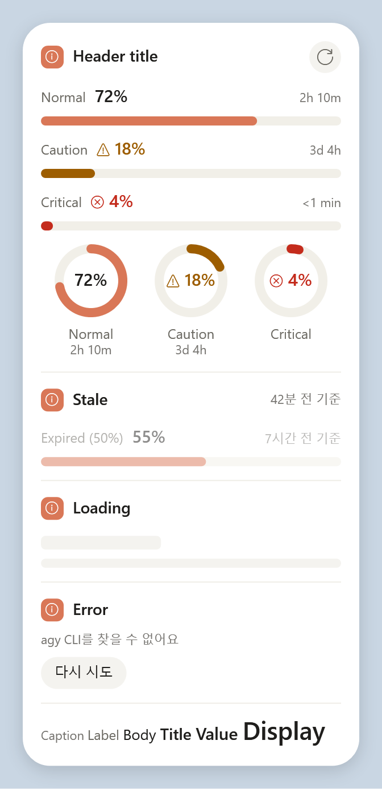
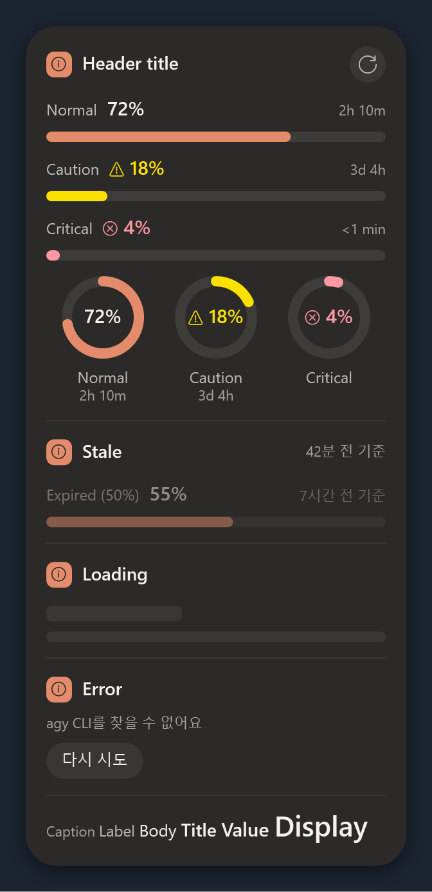
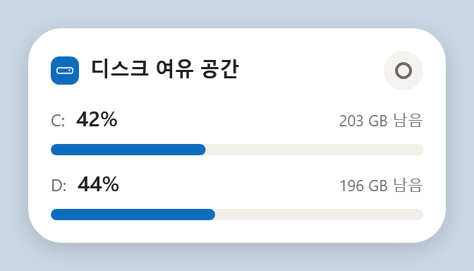
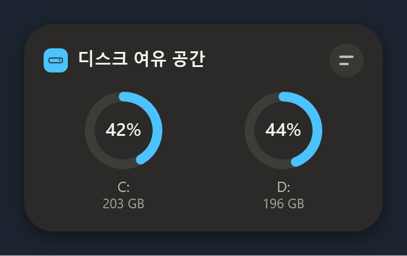

# BWUI

BWUI is a small design system for always-on Windows desktop widgets. It is one spec ([DESIGN.md](DESIGN.md)) plus a few C# files (`BWUI/`) that implement it for WPF on the .NET Framework that ships with Windows.

| Light | Dark |
|---|---|
|  |  |

## What you get

- **Spec.** Principles, a minimum checklist, tokens (4px grid, radius, type ramp, warm-gray palette with Fluent status colors), components, data states and behavior. The checklist is the common bar of Apple's, Android's and Microsoft's widget guidelines.
- **`BwuiWindow`.** A borderless card that does what a desktop widget has to do:
  - lives on the desktop layer and never takes focus;
  - stays out of the taskbar and Alt+Tab;
  - remembers its position and keeps an anchored edge in place;
  - has the standard right-click menu (refresh, size, theme, start with Windows, exit);
  - follows the Windows theme and High Contrast;
  - is per-monitor DPI aware;
  - renders `--snapshot` previews.
- **`Ui` components.** Header, icon button, text button, meter row, ring, status value with glyph, message, skeleton, divider.
- **Small footprint.** Software rendering, no dependencies, about 55 MB of RAM. It builds with `csc.exe` from `C:\Windows\Microsoft.NET` (C# 5), with no SDK or installer.
- **Korean and English** strings, plus relative-time formatting.

## Start a widget

1. Click **Use this template** on GitHub, or copy the `BWUI/` folder into your project.
2. Write a class that derives from `BwuiWindow`:

```csharp
using Bwui;

static class Program
{
    [System.STAThread]
    static void Main(string[] args) { Bwui.App.Run("MyWidget", args, () => new MyWidget()); }
}

class MyWidget : BwuiWindow
{
    public MyWidget() : base("MyWidget", "My widget") { Render(); }

    protected override System.Windows.UIElement Build()
    {
        var p = Theme.Current;
        var accent = p.Accent(Palette.Hex("#0F6CBD"), Palette.Hex("#4CC2FF"));
        var sp = new System.Windows.Controls.StackPanel();
        sp.Children.Add(Ui.Header(Ui.Icon(null, accent, Glyphs.Info), "My widget"));
        var row = Ui.MeterRow("Quota", "72%", 0.72, "2h 10m", accent, Ui.StatusForRemaining(72), ContentWidth);
        row.Margin = new System.Windows.Thickness(0, Tokens.Space3, 0, 0);
        sp.Children.Add(row);
        return sp;
    }
}
```

3. Compile with the manifest, which turns on per-monitor DPI (see [`build.ps1`](build.ps1)):

```powershell
csc /target:winexe /codepage:65001 /win32manifest:BWUI\bwui.manifest /r:...WPF dlls... BWUI\*.cs MyWidget.cs
```

4. Go through the checklist in [DESIGN.md §2](DESIGN.md#2-minimum-checklist).

## Sample

`sample/DiskWidget.cs` shows free space on fixed drives. It uses the header button, bar and ring layouts, three sizes, and status values. Build it with:

```powershell
.\build.ps1 -Run          # build and start bin\BwuiDisk.exe
.\build.ps1 -Snapshots    # render docs\*.png and docs\contrast.txt
```

| Bars | Rings, dark |
|---|---|
|  |  |

## Command line

Every BWUI widget gets these:

| Argument | Does |
|---|---|
| `--snapshot <png> [light\|dark] [extra…]` | Renders the card at 2× and exits. Extra arguments go to the widget (`App.SnapshotArgs`). |
| `--contrast <txt>` | Writes the palette contrast report (DESIGN.md C2) and exits |
| `--debug-menu` | Opens the context menu, saves it as `debug-menu.png` in the widget's data folder, and exits |

## Widgets built with BWUI

- [windows-ai-usage-widget](https://github.com/byeonggwan/windows-ai-usage-widget): Claude, Codex and Antigravity usage limits
- [windows-game-patchnote-widget](https://github.com/byeonggwan/windows-game-patchnote-widget): game patch notes

## Versioning

`BWUI/VERSION` is the spec and code version. Widgets vendor the folder and record the version they copied. While BWUI is 0.x, changing a token value or a MUST rule is a minor-version bump.

## License

MIT
